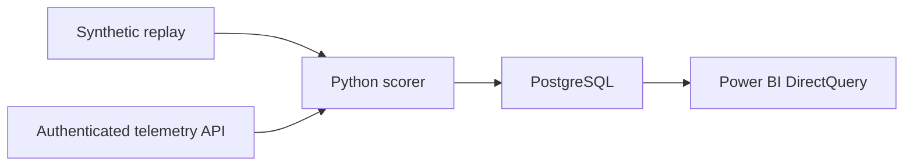

# Maintenance Watch

**Predictive maintenance monitoring with Power BI, PostgreSQL, and Python**

Maintenance Watch helps an operator see which machine readings warrant review. A Decision Tree scores uploaded CSV rows and incoming readings. The app highlights scores above 50% and can sound an alert, and Power BI tracks the live feed over time.

## Live demos

- **Pump Telemetry Copilot** scores a two-reading sample and shows the overheating alert and manual checklist. [Open Pump Telemetry Copilot](https://pump-telemetry-copilot-f7q1.onrender.com/)
- **Maintenance Watch** displays synthetic machine telemetry and scores a sample dataset with a review alert. [Open Maintenance Watch](https://maintenance-watch-live-f7q1.onrender.com/)

## Integrated release

Run Pump Telemetry Copilot and Maintenance Watch with multi-format sensor uploads, PostgreSQL, and editable Power BI reports. The sample workbooks let you follow a flagged reading from the operator screen to the report. [Integrated source and setup](https://github.com/manivasagam-rajakannan/industrial-predictive-maintenance/tree/portfolio-apps) · [Pump Telemetry Copilot repository](https://github.com/manivasagam-rajakannan/pump-telemetry-copilot)

## Try the app

Open the hosted app, select **Upload dataset**, then **Try sample**. The sample scores two readings, flags one for review, and plays a beep when sound is enabled. [Open Maintenance Watch](https://manivasagam-rajakannan.github.io/maintenance-watch/)

Use **Score CSV** to score a file with up to 10,000 readings. The result shows each row's score and any validation errors. **Download results CSV** exports every row with its result and model version. In the hosted app, scoring runs in the browser.

In Power BI Desktop, the **Fleet overview** page shows a rolling 24-hour view of machine readings, failure scores, and readings flagged for review. The **Last received UTC** card advances as the report queries new readings. The demo uses a 10-second refresh interval.

## How it works

The scorer uses product grade, air and process temperatures, rotational speed, torque, and tool wear. Docker Compose runs the monitor and PostgreSQL locally. The training script can log the fitted pipeline and holdout metrics to MLflow.

## Model evaluation

The Decision Tree was evaluated on a 2,000-row holdout from the AI4I synthetic dataset. The original training notebook is in `notebooks/`. [UCI AI4I 2020 dataset](https://archive.ics.uci.edu/dataset/601/ai4i%2B2020%2Bpredictive%2Bmaintenance%2Bdataset)

| Holdout metric | Result |
| --- | ---: |
| Accuracy | 98.3% |
| Failure precision | 72.1% |
| Failure recall | 72.1% |
| Failure readings flagged | 44 of 61 |
| Missed failure readings | 17 |
| False positives | 17 |

The portable scorer matched the fitted scikit-learn pipeline on all 2,000 holdout rows. The evaluation measures classification of individual readings with synthetic failure labels.

## Project files

| File or folder | What it contains |
| --- | --- |
| `monitor.py` and `scoring.py` | Python monitoring API and the portable Decision Tree scorer |
| `dashboard/` | Browser dashboard, CSV import, and audible review alerts |
| `powerbi/` and `powerbi_demo/` | Live Power BI project and the embedded sample report |
| `compose.yaml` and `postgres/` | Local monitor, database, and Power BI views |
| `notebooks/` and `artifacts/` | Original notebook, model export, and holdout evaluation |

Download the [complete project ZIP](MaintenanceWatch.zip) to run the Windows launcher or try the offline preview.

## Run it locally

- **Browser preview.** Download and open `MaintenanceWatch_Preview.html` to explore a replay and score a sample reading.
- **Power BI demo.** Open `OPEN_POWER_BI_DEMO.pbip` in Power BI Desktop to explore the embedded sample.
- **Continuously updating Power BI report.** On Windows with Docker Desktop and Power BI Desktop, run `REPAIR_AND_START_LIVE.cmd`, then select **Synthetic replay** on **Fleet overview**.

See [START_HERE.md](START_HERE.md) for setup, database sign-in, automatic refresh, and model reproduction.

## Paid pilot scope

Start with one machine family and a CSV export with known failure outcomes. Map the available signals and units, score the data, and review missed failures and false alerts with the customer. Deliver the input mapping, scored export, and a validation summary. Use that review to agree whether to connect a live feed and what the operator should do when a reading is flagged.
