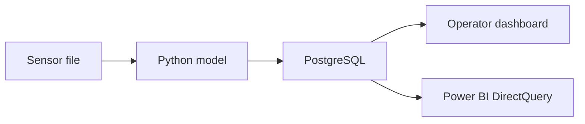

# Industrial Predictive Maintenance Apps

Manivasagam Rajakannan · Electronics and Instrumentation Engineering

Two Python apps that turn sensor files into maintenance review alerts. A user uploads readings, the model scores them, PostgreSQL stores the accepted events, and Power BI Desktop shows them through DirectQuery.



| App | Input | What you can demonstrate |
| --- | --- | --- |
| [Pump Telemetry Copilot](pump-telemetry/README.md) | Vibration, temperature, pressure, motor current | A Random Forest flags a reading. Sensor rules suggest the fault type, and the operator can open the cited training-manual checklist. The same event appears in Power BI. |
| [Maintenance Watch](maintenance-watch/README.md) | Product grade, two temperatures, speed, torque, tool wear | A Decision Tree scores readings. The app can sound a two-tone alert, export results, and send accepted rows to the Power BI live feed. |

## Upload sensor files

Try [the pump Excel sample](samples/pump-readings.xlsx) and [the machine Excel sample](samples/machine-readings.xlsx) in their respective apps. Keep the sample headings and units. The models score each row independently.

| Format | Layout |
| --- | --- |
| CSV, TSV, TXT, LOG, DAT | Headings followed by readings separated by commas, tabs, semicolons, or pipes |
| Excel `.xlsx`, `.xls`, `.xlsm`, OpenDocument `.ods` | Readings on the first worksheet, with headings in the first populated row |
| JSON, JSONL, NDJSON | Flat reading objects. JSON can contain one object, an array, or an array under `readings`, `records`, or `data`. JSONL and NDJSON use one object per line. |
| XML | One child element per reading, with a named child element for each sensor value |
| Parquet | A flat table with one sensor per column |
| Word `.docx` | Headings and readings in the first Word table |
| PDF | Bordered tables with selectable text and matching headings on each table. Up to 20 pages. |

For photos, scans, and proprietary logs, export the sensor values to a supported table first. Each app validates its required columns before scoring. Keep `telemetry_files.py` and `upload-requirements.txt` beside the two app folders when extracting the project.

## Run the apps locally

### Pump Telemetry Copilot

1. In `pump-telemetry`, double-click `OPEN_OPERATOR_SCREEN.cmd`. Keep its window open and follow the address it prints.
2. Open **Upload pump readings** and upload `samples/pump-readings.xlsx`. Select **Score and send to live feed**. One of the two sample readings is flagged as overheating. **Run sample CSV** starts the same demo without selecting a file.
3. Open `pump-telemetry/Pump_Maintenance_Live.pbip` in Power BI Desktop and select **Live Monitor**. Use **Database** authentication with the values in `pump-telemetry/.runtime/operator-database/PowerBI_connection.txt`. Compare the IST timestamp of the overheating alert in both screens.

Pump uploads accept up to 200 readings and 1 MB per file with `vibration_mm_s`, `temperature_c`, `pressure_bar`, and `motor_current_amp`. Optional `timestamp` values use ISO 8601 with a UTC offset. The API also accepts a single reading at `POST /readings`.

### Maintenance Watch

1. Keep Pump Telemetry Copilot running. Double-click `OPEN_MAINTENANCE_WATCH.cmd`. The launcher uses the running Pump database. A launcher opened from Downloads looks for the extracted project under `D:\Projects\Industrial Predictive Maintenance`.
2. In the Watch browser tab, open **Upload dataset**, choose `samples/machine-readings.xlsx`, and click **Score file**. The sample includes one normal reading and one flagged reading.
3. Open the `PowerBI_connection.txt` file at the path printed by the launcher. Paste its **Live ingest token** into Watch and select **Send scored rows to live feed**.
4. Open the **Power BI project** path printed by the launcher. Choose **Fleet overview → Live telemetry**. Both local reports use the existing Pump read-only database login.

#### Run Maintenance Watch with Docker

1. In PowerShell inside `maintenance-watch`, start Docker Desktop and run these commands.

   ```powershell
   $env:MAINTENANCE_INGEST_TOKEN = [guid]::NewGuid().ToString('N')
   docker compose up -d --build
   Set-Clipboard -Value $env:MAINTENANCE_INGEST_TOKEN
   ```

2. Open **Upload dataset**, choose `samples/machine-readings.xlsx`, and click **Score file**. The sample gives one normal score and one review alert. Maintenance Watch accepts up to 10,000 readings and 5 MB per file. [Open the local dashboard](http://127.0.0.1:8000/)
3. Paste the token from your clipboard into **Live ingest token** and select **Send scored rows to live feed**.
4. Open `maintenance-watch/powerbi/MaintenanceWatch.pbip`, select **Fleet overview → Live telemetry**, and check the flagged asset and UTC timestamp. The local connection settings are in [START_HERE.md](maintenance-watch/START_HERE.md).

When using the Docker option alongside Pump, start Maintenance Watch first so the pump launcher can choose an available API port. The existing browser demo is also available for scoring files with your account access. [Open the Maintenance Watch browser demo](https://maintenance-watch-portfolio.vasagammani2004.chatgpt.site)

## Deploy the full flow

1. Push the extracted repository root to GitHub. It contains `render.yaml`, `pump-telemetry`, and `maintenance-watch`.
2. In Render, create a Blueprint from that repository and use the root `render.yaml`. It defines two Docker web services and one shared PostgreSQL database. Open each service URL after the deployment succeeds. [Render Blueprint documentation](https://render.com/docs/infrastructure-as-code)
3. Try each app with its sample data. Render generates `PUMP_UPLOAD_TOKEN` for sending pump files to the live feed and `MAINTENANCE_INGEST_TOKEN` for sending Maintenance Watch results to the live feed. Get each value from its own service's **Environment** page.

The Blueprint uses free instances for a portfolio trial. Free Render PostgreSQL expires after 30 days. Use the sample files for the portfolio deployment. [Render free plan limits](https://render.com/docs/free)

### Connect Power BI to the hosted database

Allow your current public IP in the Render database's **Networking** settings. Use the hostname and port shown in its **External Database URL**. [Render PostgreSQL connection guide](https://render.com/docs/postgresql-creating-connecting)

Open each project in Power BI Desktop. In **Transform data → Manage Parameters**, enter the hosted settings below, then choose **Close & Apply**. Sign in using **Database** authentication with the read-only credentials. [Power Query parameters](https://learn.microsoft.com/en-us/power-query/power-query-query-parameters)

| Report | Server parameter | Database parameter | Read-only username | Password variable in Render |
| --- | --- | --- | --- | --- |
| Pump Telemetry | `PumpPostgresServer` | `PumpPostgresDatabase` = `pump_live` | `pump_reader` | `PUMP_DB_READER_PASSWORD` |
| Maintenance Watch | `WatchPostgresServer` | `WatchPostgresDatabase` = `pump_live` | `maintenance_bi` | `MAINTENANCE_BI_PASSWORD` |

## Record a one-minute portfolio demo

1. **0–10 seconds.** Introduce the problem. “An operator needs to know which pump readings to review.”
2. **10–30 seconds.** Open **Upload pump readings** and run the two-row sample. Show the overheating flag, score, and manual citation.
3. **30–50 seconds.** Switch to Power BI **Live Monitor** and point to the same fault and IST timestamp.
4. **50–60 seconds.** Show the GitHub repository and the app link so the viewer can repeat the run.

**Portfolio description**

> Built two predictive-maintenance apps that ingest sensor readings from spreadsheets, structured data files, and document tables, score them with Python models, and publish timestamped alerts to live Power BI reports through PostgreSQL DirectQuery. The pump demo includes fault-specific guidance from a training manual.

## Model evaluation

Pump Telemetry detected 32 of 33 injected faults with zero false alerts among 967 nominal readings in a chronological synthetic holdout. Maintenance Watch detected 44 of 61 failures with 17 false alerts in a 2,000-row AI4I 2020 holdout. The datasets simulate machine behavior. The scores show how the prototypes classify individual readings in those datasets. [Pump metrics](pump-telemetry/data/model_metrics.json) · [Maintenance Watch validation](maintenance-watch/artifacts/validation.json)
