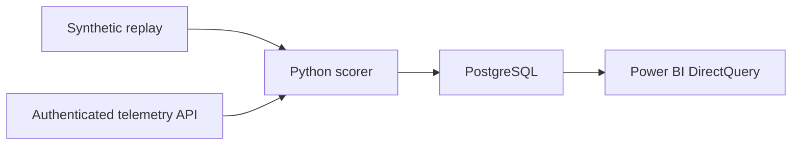

# Maintenance Watch

**Predictive maintenance monitoring with Power BI, PostgreSQL, and Python**

Maintenance Watch helps an operator see which machine readings warrant review. A Decision Tree scores uploaded sensor files and incoming readings. The app highlights scores above 50% and can sound an alert, and Power BI tracks the live feed over time.

## Try the app

Open the hosted app, select **Upload dataset**, then **Try sample**. The sample scores two readings, flags one for review, and plays a beep when sound is enabled. [Open Maintenance Watch](https://maintenance-watch-portfolio.vasagammani2004.chatgpt.site)

In the running Python app, choose **Upload dataset → Score file** to score a file with up to 10,000 readings and 5 MB. Try [the Excel sample](../samples/machine-readings.xlsx). **Download results CSV** exports each row's result and model version. The standalone browser preview scores CSV uploads. [Supported file layouts](../README.md#upload-sensor-files)

In the Python app, set `MAINTENANCE_INGEST_TOKEN` before starting the service. After scoring, enter that token and choose **Send scored rows to live feed**. Open **Fleet overview → Live telemetry** in Power BI to see the stored readings.

In Power BI Desktop, the **Fleet overview** page shows a rolling 24-hour view of machine readings, failure scores, and readings flagged for review. The **Last received UTC** card advances as the report queries new readings. The demo uses a 10-second refresh interval.

## How it works

The scorer uses product grade, air and process temperatures, rotational speed, torque, and tool wear. Docker Compose runs the monitor and PostgreSQL locally. The training script can log the fitted pipeline and holdout metrics to MLflow.

## Model evaluation

The Decision Tree was evaluated on a 2,000-row holdout from the AI4I synthetic dataset. The original training notebook is in `notebooks/`. [UCI AI4I 2020 dataset](https://archive.ics.uci.edu/dataset/601/ai4i%2B2020%2Bpredictive%2Bmaintenance%2Bdataset)

| Holdout metric | Result |
| --- | ---: |
| Accuracy | 98.3% |
| Failure precision | 72.1% |
| Failure recall | 72.1% |
| Failure readings flagged | 44 of 61 |
| Missed failure readings | 17 |
| False positives | 17 |

The portable scorer matched the fitted scikit-learn pipeline on all 2,000 holdout rows. The evaluation measures classification of individual readings with synthetic failure labels.

## Run it locally

- **Browser preview.** Download and open `MaintenanceWatch_Preview.html` to explore a replay and score a sample reading.
- **Power BI demo.** Open `OPEN_POWER_BI_DEMO.pbip` in Power BI Desktop to explore the embedded sample.
- **Continuously updating Power BI report.** On Windows with Docker Desktop and Power BI Desktop, run `REPAIR_AND_START_LIVE.cmd`, then select **Synthetic replay** on **Fleet overview**.

See [START_HERE.md](START_HERE.md) for setup, database sign-in, automatic refresh, and model reproduction.

## Paid pilot scope

Start with one machine family and a CSV export with known failure outcomes. Map the available signals and units, score the data, and review missed failures and false alerts with the customer. Deliver the input mapping, scored export, and a validation summary. Use that review to agree whether to connect a live feed and what the operator should do when a reading is flagged.
