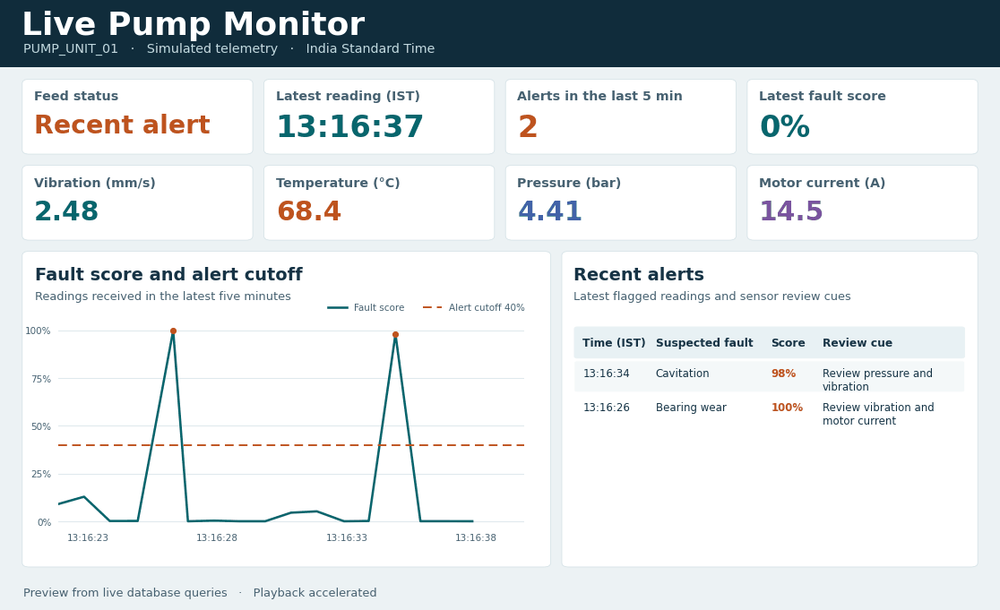
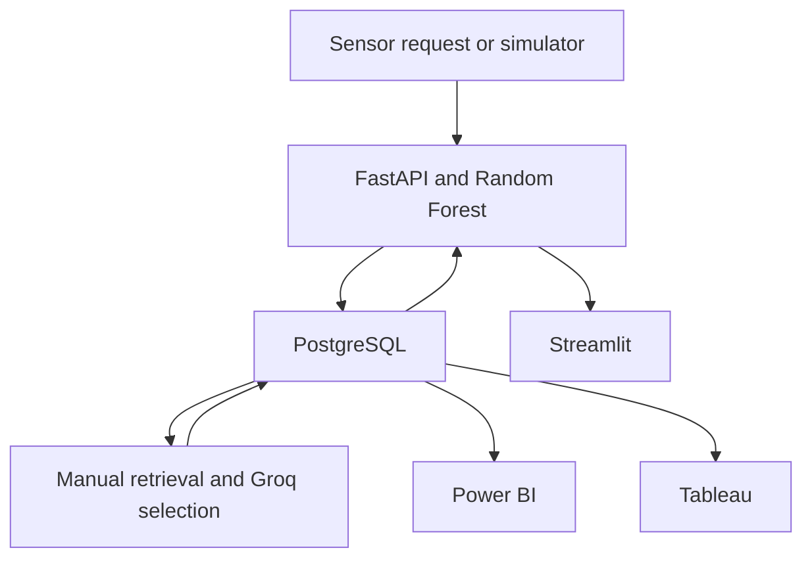

# Industrial Pump Telemetry Copilot

**Manivasagam Rajakannan** · Electronics and Instrumentation Engineering

A portfolio demo of a simulated pump. FastAPI scores incoming vibration, temperature, pressure, and motor-current readings locally. PostgreSQL stores each result. Streamlit presents the feed and page-cited troubleshooting, while Power BI and Tableau query the same database.



## Open the operator screen on Windows

1. Download the ZIP and choose **Extract All** in File Explorer.
2. Open the extracted folder and double-click `OPEN_OPERATOR_SCREEN.cmd`.
3. Keep the window open. The launcher checks the live telemetry feed before opening the browser. To reopen the current screen, use the address printed next to **Operator screen ready**.

The first run downloads the project dependencies. If a compatible 64-bit Python is available, the launcher uses it. Otherwise, it prepares Python inside the project folder. Press **Ctrl+C** in the launcher to stop the services. The database stays in the project folder for your next run. [Astral managed Python documentation](https://docs.astral.sh/uv/concepts/python-versions/)

If port 8000 or 8501 is occupied, the launcher chooses a free port for that service and prints its address. PostgreSQL uses port 55432 for the BI reports. If an earlier pump stack is using that database port, use that stack's stop command before starting the launcher. PostgreSQL setup output is in `.runtime/operator-database/postgres-setup.log`. Server messages are in `.runtime/operator-database/postgres.log`.

Live reporting views display India Standard Time using the fixed UTC+05:30 offset, which also works with the bundled Windows PostgreSQL runtime.

### Start with Docker Desktop

With Docker Desktop running, double-click `START_LIVE.cmd` or run this from the extracted project folder:

```powershell
docker compose up --build --wait
```

The Windows Docker launcher opens the page after the health checks pass. Use `STOP_LIVE.cmd` or `docker compose down` to stop Docker services. The named volume retains the readings. [Docker Compose startup](https://docs.docker.com/reference/cli/docker/compose/up/)

| Open | What to do |
| --- | --- |
| [Streamlit operator screen](http://127.0.0.1:8501) | Watch the readings advance. Choose **Overheating**, **Bearing wear**, or **Cavitation** and click **Simulate Pump Fault**. |
| [FastAPI interactive docs](http://127.0.0.1:8000/docs) | Submit a reading or inspect a scored result and its guidance. |
| [Pump training manual](http://127.0.0.1:8000/manual) | Read the exact pages referenced by the operator screen. |

The simulator sends a nominal reading about once a second. A fault button sends a labelled simulation sample through the same scoring path as a sensor API request. The alert appears immediately after scoring and the checklist appears when its background job completes.

Use **Upload pump readings → Run sample CSV** to score two readings and store them in the live feed. To test Excel, upload [pump-readings.xlsx](../samples/pump-readings.xlsx) and select **Score and send to live feed**. The app accepts up to 200 readings and 1 MB per file and checks the complete batch before writing it to PostgreSQL. [Supported file layouts](../README.md#upload-sensor-files)

### Enable Groq selection

Copy `.env.example` to `.env` and enter your Groq API key in `GROQ_API_KEY`. Restart the local launcher, or run `docker compose up -d --build` for Docker, then simulate a new fault. `openai/gpt-oss-20b` is the default model. [Groq API guide](https://console.groq.com/docs/text-chat)

With a valid key, Groq chooses relevant checklist steps from the retrieved text. The engine validates the returned IDs and displays only the cited manual wording. With an empty key, a provider error, or an invalid selection, the screen labels the result as a retrieved manual checklist.

The bundled PDF is a training manual for the simulated pump. Physical work follows the equipment manufacturer's instructions and the site's energy-control procedures. [OSHA control of hazardous energy reference](https://www.osha.gov/laws-regs/regulations/standardnumber/1910/1910.147)

## Why these layers are here

| Layer | What it does | Why it was added |
| --- | --- | --- |
| **FastAPI and the Random Forest** | Validates a four-channel reading, scores it, and returns the flag, fault score, and suspected fault. | A sensor or application can submit a reading and get a result immediately. Both the simulator and external requests use the same model. |
| **PostgreSQL** | Stores incoming readings, scores, and guidance jobs. Power BI and Tableau use read-only views. | The operator and BI reports see the same events. Event IDs protect retried API requests from duplicate records, and pending guidance survives a backend restart. |
| **LangChain, FAISS, and Groq** | Indexes the PDF with local TF-IDF embeddings. FAISS retrieves the relevant page. Groq can select steps from the retrieved checklist. | An alert can lead to a reviewable next action with a manual page citation. The PDF remains the source of each displayed instruction. |
| **Streamlit** | Shows the live clock, sensor values, score trend, alert log, and the checklist for the selected fault. | An operator or interviewer can exercise the complete workflow with one click. |
| **Power BI and Tableau** | The existing Power BI project uses DirectQuery. The Tableau workbook contains a score trend and fault-count dashboard with a live PostgreSQL connection. | Both tools can analyze the same scored readings for different reporting needs. |
| **Docker Compose** | Starts PostgreSQL, FastAPI, and Streamlit with health checks and a persistent database volume. | A fresh copy of the project can start all three services from one command. |



## Connect Power BI and Tableau

Start the stack before opening either report.

| Setting | Value |
| --- | --- |
| PostgreSQL host | `127.0.0.1` |
| Port | `55432` |
| Database | `pump_live` |
| Read-only username | `pump_reader` |
| Default demo password | `local_pump_reader_demo` |

The table shows the Docker demo password. For the local launcher, use the password in `.runtime/operator-database/PowerBI_connection.txt`. The Docker password follows `PUMP_DB_READER_PASSWORD` if you set it in `.env`. The demo ports bind to loopback. The database owner's default password is intended for this local demo. Set the database owner password before the first start if you want to change it.

**Power BI Desktop.** Open `Pump_Maintenance_Live.pbip` and choose **Live Monitor**. Use **Database** authentication. If Power BI cached the password from the previous pump replay, update the PostgreSQL credentials under **File → Options and settings → Data source settings**. The live page has five-second automatic page refresh configured. Use **Home → Refresh** once to load the historical pages on a fresh extraction. [Microsoft PostgreSQL connector](https://learn.microsoft.com/en-us/power-query/connectors/postgresql) · [Automatic page refresh](https://learn.microsoft.com/en-us/power-bi/create-reports/desktop-automatic-page-refresh)

**Tableau Desktop 2026.1 or newer.** Open `tableau_dashboard.twb`, enter the same PostgreSQL credentials, and open **Pump Telemetry - Latest Hour**. Install the PostgreSQL driver if Desktop prompts for it. Use **Data → Refresh** to query recent rows. The workbook reads the last hour from `public.tableau_telemetry`. [Tableau PostgreSQL connector](https://help.tableau.com/current/pro/desktop/en-us/examples_postgresql.htm) · [Tableau data refresh](https://help.tableau.com/current/pro/desktop/en-us/refreshing_data.htm)

## Submit a reading directly

`POST /readings` accepts the four numeric channels and an optional UTC-aware timestamp and event UUID. The default pump ID is `PUMP_UNIT_01`. Save the returned `reading_id` and query `GET /readings/{reading_id}` to check guidance. If the Windows launcher selects a different API port, use the address printed next to **Scoring API**.

```powershell
$reading = @{
    event_id = [guid]::NewGuid().ToString()
    vibration_mm_s = 2.2
    temperature_c = 94.0
    pressure_bar = 4.5
    motor_current_amp = 18.0
} | ConvertTo-Json
Invoke-RestMethod -Method Post -Uri 'http://127.0.0.1:8000/readings' -ContentType 'application/json' -Body $reading
```

Set `PUMP_SIMULATOR_ENABLED=0` in `.env` and restart the backend to use API input as your feed.

## Model and project files

The Random Forest and sensor rules come from the live project. The chronological synthetic holdout detected 32 of 33 injected faults, with 0 false alarms among 967 nominal readings. The alert cutoff is 40%. These figures measure detection in the simulation. See `data/model_metrics.json` and `model/Pump_Maintenance.ipynb`.

- `backend/` contains the API, database access, and PostgreSQL schema additions.
- `rag/` contains `pump_manual.pdf` and the retrieval and Groq selection code.
- `frontend/app.py` contains the Streamlit operator screen.
- `model/pump_pipeline.py` still rebuilds the historical snapshot for the Power BI history and validation pages. Live events flow through the API into PostgreSQL.
- `Pump_Maintenance.Report/` and `Pump_Maintenance.SemanticModel/` contain the editable Power BI project definitions. `tableau_dashboard.twb` is the Tableau workbook.

The Power BI base theme comes from Microsoft's Corporate Spend sample. Its MIT license is in `licenses/Power-BI-base-theme-MIT.txt`. [Microsoft Power BI Desktop samples](https://github.com/microsoft/powerbi-desktop-samples/tree/main/2026%20Power%20BI%20Samples%20Revamp)

## Verification

The local integration test exercised all three simulated faults, API input validation and duplicate retries, the Streamlit fault button, PDF page citations, and read-only queries from both BI views. A local Groq test endpoint exercised the request format and step-ID validation. The Tableau workbook passed the 2026.1 workbook schema and connection inspection. Docker Compose configuration and Python dependency resolution passed. A local launch test occupied port 8000, submitted a fault through the operator screen, and queried the resulting alert through the Power BI database view. The test then occupied both web ports and reopened the screen after a restart. Windows x64 dependency resolution passed. The Windows launcher, Docker Desktop launch, authenticated Groq call, and native BI report rendering are the remaining checks on the target machine.
